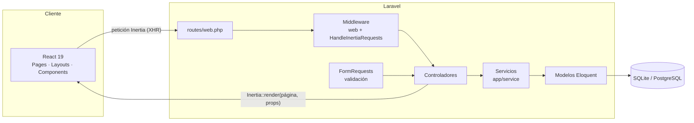
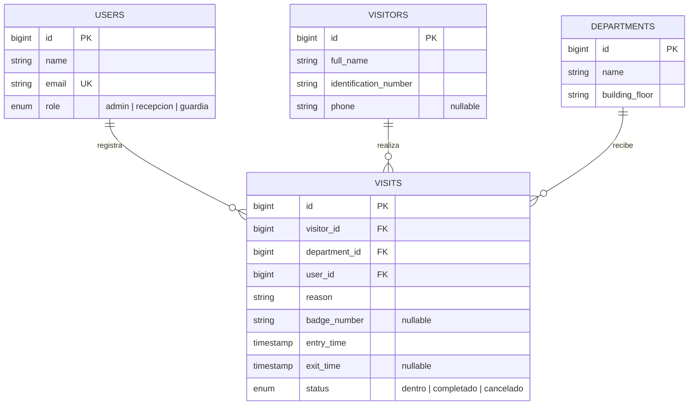
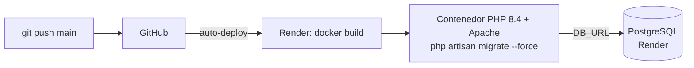

# Sistema de Registro y Control de Accesos

Aplicación web *full-stack* para registrar y auditar el flujo de **personas** y **vehículos** que ingresan a un edificio institucional: directorio de departamentos, catálogo de visitantes, bitácora de visitas con gafete y horas de entrada/salida, y control de acceso por roles.


---

## Contenido

- [Estado del proyecto](#estado-del-proyecto)
- [Stack tecnológico](#stack-tecnológico)
- [Arquitectura](#arquitectura)
- [Estructura de carpetas](#estructura-de-carpetas)
- [Instalación local (WSL 2 / Ubuntu)](#instalación-local-wsl-2--ubuntu)
- [Pruebas](#pruebas)
- [Despliegue en Render](#despliegue-en-render)
- [Documentación](#documentación)

---

## Estado del proyecto

| Módulo | Rol principal | Estado |
|---|---|---|
| Departamentos (CRUD) | Administrador | ✅ Implementado |
| Visitantes (CRUD) | Recepción | ✅ Implementado |
| Visitas: gafete, entrada, salida y estado (CRUD) | Recepción | ✅ Implementado |
| Interfaz React + Inertia con sistema de diseño Cobalt Flow | Todos | ✅ Implementado |
| Inicio de sesión y control de acceso por rol (RBAC) | Todos | 🔲 Planeado |
| Botón "Marcar Salida" automático | Recepción | 🔲 Planeado |
| Bitácora vehicular | Guardia | 🔲 Planeado |
| Gestión de usuarios y roles | Administrador | 🔲 Planeado |

El plan detallado de lo que falta está en [docs/ROADMAP_BACKEND_PENDIENTE.md](docs/ROADMAP_BACKEND_PENDIENTE.md).

---

## Stack tecnológico

| Capa | Tecnología |
|---|---|
| Backend | PHP 8.4, Laravel 13 (MVC + Capa de Servicios + FormRequests) |
| Puente backend–frontend | Inertia.js 3 (`inertiajs/inertia-laravel` + `@inertiajs/react`) |
| Frontend | React 19, Vite 8 |
| Estilos y UI | Tailwind CSS 4, sistema de diseño **Cobalt Flow** (`#3d52d5` / `#eaf0f9`), iconos `lucide-react`, notificaciones `sonner` |
| Base de datos | SQLite (local y pruebas) · PostgreSQL (producción) |
| Pruebas | PHPUnit 12 (Feature Tests) |
| Infraestructura | Docker (PHP 8.4 + Apache + Node.js LTS), Render (PaaS) con despliegue automático desde GitHub |

---

## Arquitectura

El sistema sigue un patrón **MVC extendido con Capa de Servicios**. La vista son componentes React que Inertia.js entrega como una SPA, sin necesidad de una API REST separada.



| Capa | Responsabilidad |
|---|---|
| **FormRequest** | Valida y rechaza los datos antes de llegar al controlador |
| **Controlador** | Coordina: llama al servicio y responde con una página de Inertia o una redirección con mensaje flash |
| **Servicio** | Concentra el acceso a datos y la lógica de negocio reutilizable |
| **Modelo** | Tabla, relaciones, *casts* y normalización de datos (mutadores/accesores) |
| **Página React** | Recibe los datos como *props* y los presenta |

### Modelo de datos



---

## Estructura de carpetas

```text
.
├── app/
│   ├── Http/
│   │   ├── Controllers/        # Departments, Visitor, Visit, home, User (pendiente)
│   │   ├── Middleware/         # HandleInertiaRequests (comparte mensajes flash)
│   │   └── Requests/           # FormRequests por módulo: Departments/, Visitors/, Visits/
│   ├── Models/                 # User, departments, visitors, visits
│   └── service/                # Capa de servicios: departments/, visitors/, visits/
├── database/
│   ├── factories/              # Datos ficticios para pruebas
│   ├── migrations/             # Esquema de la base de datos
│   └── seeders/                # Datos iniciales
├── docs/                       # Documentación técnica, manual, reportes y diseño
├── public/                     # Punto de entrada web, logo, favicon y build de Vite
├── resources/
│   ├── css/app.css             # Tailwind 4 + tokens de Cobalt Flow
│   ├── js/
│   │   ├── app.jsx             # Arranque de Inertia + React
│   │   ├── Components/
│   │   │   ├── Feedback/       # FlashToaster (notificaciones sonner)
│   │   │   ├── Forms/          # FormField, TextInput, SelectInput, FormShell
│   │   │   └── UI/             # Button, Badge, Card, Table, Pagination, StatCard...
│   │   ├── Layouts/            # AppLayout (barra lateral y contenedor)
│   │   ├── Pages/              # Una carpeta por módulo: Home, Departments, Visitors, Visits
│   │   └── lib/                # Utilidades: formato de fechas, catálogo de estados
│   └── views/app.blade.php     # Única plantilla Blade: raíz de la SPA
├── routes/web.php              # Rutas de la aplicación
├── tests/Feature/              # Pruebas de integración de los CRUD
├── Dockerfile                  # Imagen de producción (Node build + PHP/Apache)
└── render.yaml                 # Infraestructura como código para Render
```

**Convenciones del frontend:**

- Cada página de `Pages/` corresponde al nombre que envía el controlador con `Inertia::render('Modulo/Pagina')`.
- Los componentes de `Components/UI/` no conocen la lógica de negocio: solo reciben *props*.
- Los colores de módulo son constantes: Visitas = cobalto, Visitantes = cielo, Departamentos = violeta. Los colores de estado también: en edificio = esmeralda, salida registrada = gris, alerta = ámbar, error = rosa.

---

## Instalación local (WSL 2 / Ubuntu)

### Requisitos

| Herramienta | Versión |
|---|---|
| PHP | 8.3 o superior (producción usa 8.4) con `pdo_sqlite`, `mbstring`, `xml`, `curl`, `zip`, `bcmath` |
| Composer | 2.x |
| Node.js | 22 LTS (recomendado instalar con NVM) |
| Git | 2.x |

> Clona el proyecto dentro del sistema de archivos de Linux (`~/proyectos/`), no en `/mnt/c/`, para que Vite y Composer funcionen a velocidad normal.

### Pasos

```bash
# 1. Clonar e instalar dependencias
git clone <URL-del-repositorio> ~/proyectos/curso-laravel
cd ~/proyectos/curso-laravel
composer install
npm install

# 2. Configurar el entorno
cp .env.example .env
php artisan key:generate
touch database/database.sqlite
php artisan migrate --seed

# 3. Levantar los servidores (dos terminales)
php artisan serve        # Terminal 1 → backend en http://localhost:8000
npm run dev              # Terminal 2 → Vite con recarga en caliente
```

Abre **http://localhost:8000** en el navegador de Windows.

> Alternativa en una sola terminal: `composer run dev`.

| Problema | Solución |
|---|---|
| `Vite manifest not found` | Ejecuta `npm run dev` o `npm run build` |
| `could not find driver` | `sudo apt install php8.4-sqlite3` |
| `No application encryption key` | `php artisan key:generate` |
| `no such table` | `php artisan migrate` |

---

## Pruebas

```bash
php artisan test                          # suite completa
php artisan test --filter=VisitsCrudTest  # un archivo
composer test                             # limpia caché de configuración y ejecuta
```

Las pruebas usan SQLite en memoria (`phpunit.xml`) y nunca tocan la base de datos de producción. Estado actual: **29 pruebas, 164 aserciones, 0 fallos**.

| Archivo | Cubre |
|---|---|
| `DepartmentCrudTest` | Listado, alta, nombre duplicado, edición, eliminación, 404 |
| `VisitorsCrudTest` | Listado, alta, identificación duplicada, edición, eliminación, 404 |
| `VisitsCrudTest` | Listado, alta, llaves foráneas inválidas, edición, eliminación, 404 |

---

## Despliegue en Render



1. **Imagen base** `php:8.4-apache` con extensiones (`pdo_pgsql`, `zip`, `mbstring`...) y Node.js 22 LTS.
2. **Build:** `composer install --no-dev --optimize-autoloader`, `npm install` y `npm run build`, que genera `public/build/`. Apache apunta a `/public` con `mod_rewrite` activo.
3. **Arranque:** `php artisan migrate --force && apache2-foreground`. Las migraciones corren al iniciar el contenedor porque el plan gratuito de Render no permite *Pre-Deploy Command*.

**HTTPS:** Render termina TLS en su proxy. `bootstrap/app.php` confía en ese proxy (`trustProxies`) y `AppServiceProvider` fuerza `https` en producción. Sin esto, los assets se generan con `http://` y el navegador los bloquea (pantalla blanca).

Variables principales definidas en `render.yaml`:

| Variable | Valor |
|---|---|
| `APP_ENV` / `APP_DEBUG` | `production` / `false` |
| `APP_KEY` | Generada por Render |
| `DB_CONNECTION` | `pgsql` |
| `DB_URL` | Cadena de conexión de la base `curso-laravel-db` |
| `DB_SSLMODE` | `require` |

> El arranque ya no ejecuta seeders. Para crear el primer administrador en producción, sigue la Fase 7 del [roadmap](docs/ROADMAP_BACKEND_PENDIENTE.md).

---

## Documentación

| Documento | Para quién | Contenido |
|---|---|---|
| [DOCUMENTACION_TECNICA.md](docs/DOCUMENTACION_TECNICA.md) | Evaluación académica / equipo técnico | Arquitectura, ERD, diccionario de datos, RBAC, casos de uso, DevOps, testing |
| [MANUAL_USUARIO.md](docs/MANUAL_USUARIO.md) | Operadores (Admin, Recepción, Guardia) | Uso paso a paso de cada módulo |
| [ROADMAP_BACKEND_PENDIENTE.md](docs/ROADMAP_BACKEND_PENDIENTE.md) | Desarrollador | Auditoría del backend y plan de implementación |
| [ESPECIFICACION_WIZARD.md](docs/ESPECIFICACION_WIZARD.md) | Diseño | Sistema de diseño Cobalt Flow y especificación del Modal Wizard |
| [DESIGN_SYSTEM.md](docs/DESIGN_SYSTEM.md) | Diseño | Referencia de estilo externa ("Doppler", tema oscuro) usada como inspiración |
