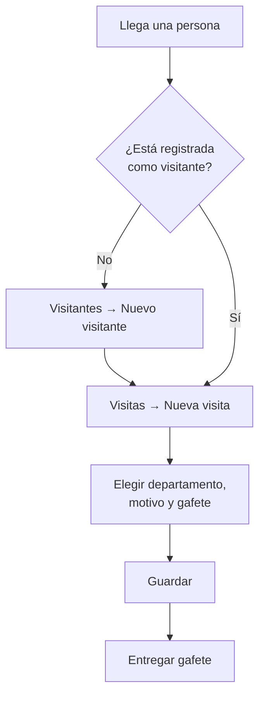

# Manual de Usuario

**Sistema de Registro y Control de Accesos** · Versión 1.0 · Octubre 2026

Este manual explica cómo usar el sistema día a día. Está dirigido al personal que lo opera: **Administración**, **Recepción** y **Guardia / Caseta**.

> **Cómo leer este manual.** Las funciones marcadas como **✅ Disponible** ya se pueden usar. Las marcadas como **🔜 Próximamente** forman parte del diseño aprobado y se describen para que el personal conozca el flujo que tendrá el sistema cuando estén terminadas.

---

## Contenido

1. [Antes de empezar](#1-antes-de-empezar)
2. [Conceptos básicos](#2-conceptos-básicos)
3. [Conociendo la pantalla](#3-conociendo-la-pantalla)
4. [Módulo de Visitas](#4-módulo-de-visitas)
5. [Módulo de Visitantes](#5-módulo-de-visitantes)
6. [Módulo de Departamentos](#6-módulo-de-departamentos)
7. [Guía rápida por rol](#7-guía-rápida-por-rol)
8. [Mensajes del sistema y cómo resolverlos](#8-mensajes-del-sistema-y-cómo-resolverlos)
9. [Preguntas frecuentes](#9-preguntas-frecuentes)

---

## 1. Antes de empezar

| Necesitas | Detalle |
|---|---|
| Un navegador actualizado | Google Chrome, Microsoft Edge o Firefox |
| La dirección del sistema | La proporciona el administrador (por ejemplo, `https://<sistema>.onrender.com`) |
| Conexión a internet | El sistema funciona en la nube; no requiere instalación |

> **Inicio de sesión — 🔜 Próximamente.** En la versión actual el sistema abre directamente el panel principal. Cuando se active el inicio de sesión, cada operador entrará con su correo y contraseña, y solo verá los módulos que corresponden a su rol.

> **Primera carga lenta.** En el plan gratuito de Render, si nadie ha usado el sistema por un rato, la primera página puede tardar hasta un minuto en abrir. Después funciona con normalidad.

---

## 2. Conceptos básicos

### 2.1 Roles

| Rol | Qué hace | Módulos |
|---|---|---|
| **Administrador** | Supervisa todo el sistema, da de alta departamentos y usuarios, y puede eliminar registros | Todos |
| **Recepción** | Recibe a las personas en el mostrador: registra visitantes, asigna gafete, indica el departamento destino y registra la salida | Visitantes y Visitas |
| **Guardia / Caseta** | Controla la entrada y salida de vehículos en el acceso | Vehículos (🔜) y consulta de Visitas |

### 2.2 Visitante y visita

- **Visitante:** la *persona*. Se registra una sola vez con su nombre y número de identificación.
- **Visita:** cada *ingreso* de esa persona al edificio. Un mismo visitante puede tener muchas visitas a lo largo del tiempo.

### 2.3 Estados de una visita

Cada visita muestra una etiqueta de color que indica su situación:

| Etiqueta | Color | Significado |
|---|---|---|
| ● **En edificio** | Verde (con punto parpadeante) | La persona entró y todavía no registra salida |
| ✓ **Salida registrada** | Gris | La persona ya salió; la visita está cerrada |
| ✕ **Cancelada** | Rosa | La visita se anuló (por ejemplo, se registró por error) |

### 2.4 Otros indicadores de color

| Indicador | Color | Significado |
|---|---|---|
| Gafete con número (p. ej. `GAF-05`) | Azul | Gafete entregado |
| **No asignado** | Ámbar | La persona no tiene gafete; revisar si debe entregársele uno |
| **No registrado** | Gris | El visitante no proporcionó teléfono |

---

## 3. Conociendo la pantalla

### 3.1 Barra lateral (menú)

En computadora aparece a la izquierda; en celular, en la parte superior.

| Sección | Opciones |
|---|---|
| **Operación** | Inicio · Visitas · Visitantes · Departamentos |
| **Próximamente** | Vehículos · Usuarios y roles (aparecen con un candado 🔒 y todavía no se pueden abrir) |

La opción en la que te encuentras se resalta en azul.

### 3.2 Panel principal (Inicio)

- Botón **Registrar visita**: lleva directamente al formulario de nueva visita.
- Botón **Nuevo visitante**: registra a una persona nueva.
- Tarjetas de **Módulos**: acceso a Visitas, Visitantes y Departamentos.
- **Próximos módulos** y **Roles del sistema**: información de referencia.

### 3.3 Elementos comunes

| Elemento | Cómo funciona |
|---|---|
| **Notificaciones** | Al guardar, actualizar o eliminar, aparece un aviso verde en la esquina superior derecha. Se cierra solo o con la ✕. |
| **Paginación** | Los listados muestran 10 registros por página. Usa los números o las flechas ‹ › en la parte inferior de la tabla. |
| **Botones de cada fila** | **Ver** (detalle), **Editar** (modificar) y **Eliminar** (pide confirmación). |
| **Campos con error** | Se marcan en rojo con un mensaje debajo que explica qué corregir. |
| **Campos opcionales** | Llevan la etiqueta *Opcional* junto al nombre. Todos los demás son obligatorios. |

---

## 4. Módulo de Visitas

### 4.1 Consultar las visitas ✅

1. En el menú, haz clic en **Visitas**.
2. En la parte superior verás cuatro indicadores:
   - **Visitas registradas:** total histórico.
   - **En edificio:** personas dentro *en la página que estás viendo*.
   - **Salidas registradas:** visitas cerradas *en la página que estás viendo*.
   - **Dentro sin gafete:** se pone en ámbar si alguna persona dentro no tiene gafete.
3. La **Bitácora de visitas** muestra primero las entradas más recientes.

### 4.2 Registrar una visita ✅

> **Antes de empezar:** la persona debe estar registrada como visitante. Si no lo está, regístrala primero (sección 5.2) o usa el enlace **Registrar visitante** que aparece dentro del formulario.

1. Haz clic en **Nueva visita** (o en **Registrar visita** desde Inicio).
2. **Sección 1 · Visitante y destino**
   - **Visitante:** elige a la persona de la lista (aparece nombre e identificación).
   - **Departamento:** elige el área que visitará.
   - **Usuario responsable:** elige tu nombre.
3. **Sección 2 · Detalle de la visita**
   - **Motivo:** describe brevemente la razón (p. ej. "Entrega de documentos").
   - **Número de gafete** *(opcional)*: escribe el número del gafete entregado.
4. **Sección 3 · Horario y estado**
   - **Entrada:** fecha y hora de ingreso.
   - **Salida** *(opcional)*: déjalo vacío al registrar la entrada.
   - **Estado:** deja **Dentro**.
5. Haz clic en **Guardar**. Verás la notificación *"Visita creada correctamente."*

> **🔜 Próximamente — Registro guiado en 4 pasos (Modal Wizard).** El registro se hará en una ventana con pasos: **1. Visitante** (buscar o dar de alta en el momento) → **2. Destino** (departamento y motivo) → **3. Gafete** → **4. Confirmación**. El usuario responsable y la hora de entrada se asignarán automáticamente.

### 4.3 Registrar la salida de una persona

**Forma actual ✅**

1. En **Visitas**, localiza la visita con la etiqueta verde **En edificio**.
2. Haz clic en **Editar**.
3. En **Salida**, escribe la fecha y hora en que la persona se retira.
4. Cambia **Estado** a **Completado**.
5. Haz clic en **Actualizar**.

> La hora de salida no puede ser anterior a la de entrada; si lo es, el sistema mostrará el error *"La salida debe ser posterior o igual a la entrada."*

**🔜 Próximamente — Botón "Marcar Salida"**

Cada visita en curso tendrá un botón **Marcar Salida**. Con un solo clic el sistema registrará la hora exacta y cambiará el estado a **Salida registrada**. Si se presiona dos veces, no se sobrescribe la hora original.

### 4.4 Ver el detalle de una visita ✅

Haz clic en **Ver**. La pantalla muestra:

- Visitante, identificación, departamento y su ubicación, gafete, usuario responsable y motivo.
- **Tiempos de estancia:** hora de entrada, hora de salida y la **duración** de la visita (o el *tiempo en el edificio* si la persona sigue dentro).

### 4.5 Corregir o cancelar una visita ✅

- **Corregir datos:** **Editar** → modifica → **Actualizar**.
- **Anular una visita registrada por error:** **Editar** → **Estado: Cancelado** → **Actualizar**. Se recomienda cancelar en lugar de eliminar, para conservar el historial.
- **Eliminar:** **Eliminar** → confirma. ⚠️ No se puede deshacer.

---

## 5. Módulo de Visitantes

### 5.1 Consultar visitantes ✅

Menú → **Visitantes**. La tabla muestra nombre, identificación, teléfono y fecha de registro, empezando por los más recientes.

### 5.2 Registrar un visitante ✅

1. Haz clic en **Nuevo visitante**.
2. Completa:
   - **Nombre completo:** tal como aparece en la identificación.
   - **Número de identificación:** de la INE, licencia de conducir o credencial institucional.
   - **Teléfono** *(opcional)*.
3. Haz clic en **Guardar**.

> Si el número de identificación ya existe, el sistema mostrará *"Este numero de identificacion ya existe."* Eso significa que la persona ya está registrada: búscala en el listado y crea directamente su visita.

### 5.3 Ver, editar y eliminar ✅

- **Ver:** tarjeta con los datos de la persona y las fechas de registro y última actualización.
- **Editar:** corrige nombre, identificación o teléfono → **Actualizar**.
- **Eliminar:** ⚠️ **al eliminar un visitante también se eliminan todas sus visitas.** Úsalo solo para registros duplicados o erróneos.

---

## 6. Módulo de Departamentos

### 6.1 Consultar el directorio ✅

Menú → **Departamentos**. Muestra cada área, su edificio o piso y la fecha de alta.

### 6.2 Dar de alta un departamento ✅ *(Administrador)*

1. Haz clic en **Nuevo departamento**.
2. Escribe el **Nombre del departamento** (p. ej. "Recursos Humanos") y su **Edificio / Piso** (p. ej. "Planta baja").
3. Haz clic en **Guardar**.

> El sistema no permite dos departamentos con el mismo nombre: *"Este departamento ya existe."*

### 6.3 Editar y eliminar ✅ *(Administrador)*

- **Editar:** cambia el nombre o la ubicación → **Actualizar**.
- **Eliminar:** ⚠️ **elimina también todas las visitas registradas a ese departamento.**

---

## 7. Guía rápida por rol

### 7.1 Recepción

**Al llegar una persona:**

**Al retirarse:**

1. Recibir el gafete.
2. Visitas → localizar la visita **En edificio** → registrar la salida (sección 4.3).

**Al final del turno:** revisar en **Visitas** que no queden personas **En edificio** que ya se hayan retirado, y atender el indicador **Dentro sin gafete**.

| Tarea | Estado |
|---|---|
| Registrar visitantes y visitas | ✅ |
| Registrar salida editando la visita | ✅ |
| Botón "Marcar Salida" | 🔜 |
| Registro guiado en 4 pasos | 🔜 |

### 7.2 Guardia / Caseta

| Tarea | Estado |
|---|---|
| Consultar **Visitas** para confirmar si una persona tiene un ingreso registrado | ✅ |
| Registrar la entrada de un vehículo: placas, marca, color y tipo (sedán, camioneta, motocicleta, pickup, otro) | 🔜 |
| Registrar la salida del vehículo con un botón | 🔜 |
| Aviso automático si unas placas ya tienen un ingreso abierto | 🔜 |

**Flujo proyectado de la bitácora vehicular:**

1. Menú → **Vehículos** → **Registrar entrada**.
2. Escribir las placas (el sistema las convierte a mayúsculas), marca y color, y elegir el tipo de vehículo.
3. Opcional: asociarlo a un visitante registrado o escribir el nombre del conductor.
4. **Guardar**: la hora de entrada se registra automáticamente.
5. Al salir el vehículo: botón **Marcar salida**.

### 7.3 Administrador

| Tarea | Estado |
|---|---|
| Alta, edición y baja de departamentos | ✅ |
| Supervisar y corregir visitantes y visitas | ✅ |
| Eliminar registros erróneos | ✅ |
| Crear usuarios, asignar su rol y desactivarlos | 🔜 |
| Panel de métricas reales: visitas del día, personas y vehículos dentro | 🔜 |

**Recomendaciones de administración:**

- Antes de eliminar un departamento o visitante, considera que **se borran sus visitas**.
- Prefiere **cancelar** visitas en lugar de eliminarlas, para conservar la bitácora.

---

## 8. Mensajes del sistema y cómo resolverlos

| Mensaje | Causa | Qué hacer |
|---|---|---|
| *Este departamento ya existe.* | Ya hay un departamento con ese nombre | Usa el existente o cambia el nombre |
| *Este numero de identificacion ya existe.* | La persona ya está registrada | Búscala en Visitantes y registra solo su visita |
| *El visitante seleccionado no existe.* | El visitante fue eliminado mientras llenabas el formulario | Recarga la página y vuelve a elegir |
| *La salida debe ser posterior o igual a la entrada.* | La hora de salida es anterior a la entrada | Revisa la fecha y la hora |
| *The … field is required.* | Falta un campo obligatorio | Completa los campos marcados en rojo |
| Página **404** | El registro ya no existe | Regresa al listado |
| La página tarda en abrir | El servidor gratuito estaba en reposo | Espera unos segundos; la siguiente carga será rápida |

---

## 9. Preguntas frecuentes

**¿Puedo registrar una visita sin gafete?**
Sí, el gafete es opcional. La visita aparecerá con la etiqueta ámbar **No asignado** y contará en el indicador **Dentro sin gafete**.

**¿Por qué el indicador "En edificio" no coincide con el total?**
Por ahora ese indicador cuenta solo las visitas de la página que estás viendo. Cuando se active el panel de métricas, mostrará el total real.

**Registré mal una visita, ¿la borro?**
Mejor cámbiala a estado **Cancelado**. Así queda constancia de lo ocurrido.

**¿Funciona en el celular?**
Sí. El menú pasa a la parte superior y las tablas se pueden desplazar hacia los lados.

**¿Quién puede ver la información?**
En la versión actual, cualquier persona con la dirección del sistema. Cuando se active el inicio de sesión, cada usuario verá solo los módulos de su rol.
