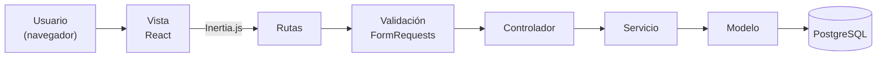
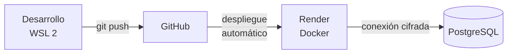

# Reporte Ejecutivo de Servicio Social

## Sistema de Registro y Control de Accesos

| Campo | Información |
|---|---|
| Prestador(a) de Servicio Social | *[Nombre completo]* |
| Matrícula | *[Matrícula]* |
| Carrera | *[Ingeniería en Sistemas Computacionales]* |
| Institución educativa | *[Nombre de la institución]* |
| Dependencia receptora | *[Nombre de la dependencia]* |
| Supervisor(a) | *[Nombre del supervisor(a)]* |
| Periodo que se reporta | 24 de agosto – 22 de octubre de 2026 |
| Fecha de entrega | *[Fecha]* |

---

## 1. Resumen ejecutivo

Durante el periodo reportado se diseñó, desarrolló y publicó en la nube la primera versión del **Sistema de Registro y Control de Accesos**: una aplicación web que sustituye la bitácora en papel del edificio por un registro digital, consultable y auditable de las personas que ingresan.

**Resultados principales:**

- **Tres módulos operativos** en producción: Departamentos, Visitantes y Visitas (con gafete, hora de entrada, hora de salida y estado).
- **Arquitectura profesional en capas** (MVC + Capa de Servicios + validación desacoplada), preparada para crecer hacia el modelo de tres roles: Administrador, Recepción y Guardia.
- **Interfaz moderna** construida con React e Inertia.js, adaptable a computadora y celular, con un sistema de diseño institucional propio ("Cobalt Flow").
- **Calidad verificada:** 29 pruebas automatizadas con 164 comprobaciones, todas exitosas.
- **Despliegue en la nube** con Docker y Render, conectado a una base de datos PostgreSQL administrada y con publicación automática desde GitHub.

El sistema es funcional para el registro de visitas. Para su uso institucional pleno faltan el **inicio de sesión con control por roles** y los módulos de **vehículos** y **usuarios**. Estos componentes ya están diseñados y su plan de implementación está documentado (sección 9).

---

## 2. Problemática atendida

| Situación anterior | Consecuencia | Respuesta del sistema |
|---|---|---|
| Bitácora en papel | Registros ilegibles, incompletos o extraviados | Captura estructurada con campos obligatorios y validación |
| Sin visibilidad de quién está dentro del edificio | Riesgo de seguridad y en evacuaciones | Estado de cada visita: *En edificio*, *Salida registrada*, *Cancelada* |
| Control informal de gafetes | Gafetes no devueltos | Gafete ligado a cada visita y alerta de visitas sin gafete |
| Recaptura de datos de visitantes frecuentes | Tiempo de atención elevado | Catálogo único de visitantes |
| Sin control vehicular | No se sabe qué vehículos hay en el estacionamiento | Bitácora vehicular (diseñada, en desarrollo) |

---

## 3. Objetivos y grado de cumplimiento

**Objetivo general:** desarrollar una aplicación web que registre y controle el acceso de personas y vehículos al edificio, con trazabilidad y control por roles.

| # | Objetivo específico | Cumplimiento |
|---|---|---|
| 1 | Modelar la base de datos de departamentos, visitantes, visitas y usuarios | ✅ Completo |
| 2 | Implementar la gestión (alta, consulta, edición y baja) de departamentos, visitantes y visitas | ✅ Completo |
| 3 | Aplicar una arquitectura en capas mantenible | ✅ Completo |
| 4 | Construir una interfaz moderna y adaptable a dispositivos móviles | ✅ Completo |
| 5 | Garantizar la calidad mediante pruebas automatizadas | ✅ Completo para los módulos actuales |
| 6 | Publicar el sistema en un entorno de producción en la nube | ✅ Completo |
| 7 | Implementar inicio de sesión y control de acceso por roles | 🔲 Diseñado, pendiente de programar |
| 8 | Implementar la bitácora vehicular para el rol Guardia | 🔲 Diseñado, pendiente de programar |
| 9 | Implementar la administración de usuarios | 🔲 Diseñado, pendiente de programar |

**Avance global estimado:** 6 de 9 objetivos completos (≈ 67 %).

---

## 4. Cronología de actividades

| Periodo | Actividad | Entregable |
|---|---|---|
| 24 – 28 ago 2026 | Configuración del entorno (WSL 2, PHP, Node.js), estudio del framework Laravel: rutas, controladores y vistas | Proyecto base |
| 31 ago – 06 sep 2026 | Conexión a base de datos, migraciones, modelos Eloquent, *casts*, *seeders* y *factories* | Esquema de datos y datos de prueba |
| 11 – 23 sep 2026 | Módulo de Departamentos completo con capa de servicios y validación | CRUD + 9 pruebas |
| 23 – 28 sep 2026 | Módulo de Visitantes | CRUD + 9 pruebas |
| 28 – 30 sep 2026 | Módulo de Visitas (gafete, entrada, salida, estado) | CRUD + 9 pruebas |
| 30 sep – 01 oct 2026 | Contenedorización con Docker y despliegue en Render con PostgreSQL | Sistema publicado en la nube |
| 14 oct 2026 | Migración de la interfaz de plantillas Blade a React con Inertia.js | SPA en React |
| 19 – 22 oct 2026 | Rediseño visual con el sistema Cobalt Flow, documentación técnica, manual de usuario y auditoría del backend | Documentación completa y hoja de ruta |

---

## 5. Arquitectura implementada

### 5.1 Patrón MVC con Capa de Servicios

El sistema separa responsabilidades en capas. Cada una puede modificarse sin afectar a las demás:

| Capa | Función | Beneficio para la institución |
|---|---|---|
| **Validación (FormRequests)** | Revisa los datos antes de guardarlos: campos obligatorios, identificaciones no duplicadas, salida posterior a la entrada | Información confiable desde el origen |
| **Controlador** | Coordina cada petición | Código ordenado y fácil de auditar |
| **Servicio** | Concentra la lógica de negocio | Las reglas se reutilizan y se prueban en un solo lugar |
| **Modelo** | Representa cada tabla y sus relaciones | Consultas seguras contra inyección SQL |

### 5.2 Migración a React con Inertia.js

Las pantallas se reconstruyeron como una **aplicación de una sola página (SPA)** en React. Inertia.js conecta React con Laravel sin necesidad de crear una API independiente.

**Resultados de la migración:**

- Navegación sin recargas completas de página.
- **23 componentes reutilizables** (botones, tablas, formularios, insignias de estado, paginación) que garantizan una apariencia uniforme.
- Sistema de diseño **Cobalt Flow**: azul institucional `#3d52d5`, fondo `#eaf0f9` y colores semánticos (verde = en edificio, gris = salida registrada, ámbar = alerta, rojo = error).
- Diseño adaptable a celular y tableta.
- Notificaciones de confirmación y mensajes de error claros en español.
- Accesibilidad: etiquetas visibles en cada campo, navegación por teclado y respeto a la preferencia de "movimiento reducido".

### 5.3 Base de datos

| Entorno | Motor | Uso |
|---|---|---|
| Producción | **PostgreSQL** (administrado por Render, conexión cifrada SSL) | Datos reales |
| Desarrollo y pruebas | SQLite | Trabajo local y pruebas automatizadas aisladas |

El esquema se versiona mediante **migraciones**, por lo que cualquier cambio en la estructura se aplica de forma controlada y reproducible en todos los entornos. Las relaciones están protegidas con **llaves foráneas**: una visita siempre referencia a un visitante, un departamento y un usuario existentes.

---

## 6. Aseguramiento de la calidad

| Indicador | Resultado |
|---|---|
| Pruebas automatizadas | **29** |
| Comprobaciones (aserciones) | **164** |
| Pruebas exitosas | **100 %** |
| Tiempo de ejecución de la suite | < 1 segundo |

Cada módulo cuenta con pruebas que verifican: listado, alta, rechazo de datos incompletos, reglas de negocio (duplicados, referencias inválidas), edición, eliminación y respuesta ante registros inexistentes. Las pruebas usan una base de datos temporal en memoria, por lo que **nunca afectan la información de producción**.

---

## 7. Infraestructura y despliegue

- **Docker:** el sistema se empaqueta en una imagen que contiene PHP 8.4, Apache y la interfaz ya compilada. El mismo paquete funciona igual en cualquier servidor.
- **Render (PaaS):** cada cambio publicado en GitHub se despliega automáticamente. Al arrancar, el sistema aplica las migraciones pendientes de la base de datos.
- **Configuración segura:** las credenciales de la base de datos y la llave de cifrado se inyectan como variables de entorno; no se almacenan en el código.

---

## 8. Indicadores del producto

| Indicador | Valor |
|---|---|
| Módulos funcionales | 3 (Departamentos, Visitantes, Visitas) |
| Rutas web | 22 |
| Tablas de negocio | 4 (`users`, `departments`, `visitors`, `visits`) |
| Pantallas React | 9 |
| Componentes de interfaz reutilizables | 23 |
| Documentos entregados | 6 (ver Anexos) |

---

## 9. Pendientes y plan de continuidad

La auditoría técnica realizada al cierre del periodo identificó las tareas necesarias para completar el modelo de tres roles. Están ordenadas por prioridad en `docs/ROADMAP_BACKEND_PENDIENTE.md`.

| Prioridad | Actividad | Rol beneficiado |
|---|---|---|
| 1 | Inicio de sesión y protección de todas las rutas | Todos |
| 2 | Control de acceso por rol (RBAC) | Todos |
| 3 | Botón "Marcar Salida" y asignación automática del operador y la hora de entrada | Recepción |
| 4 | Bitácora vehicular: placas, marca, color, tipo, entrada y salida | Guardia |
| 5 | Administración de usuarios y roles | Administrador |
| 6 | Panel de métricas en tiempo real | Administrador |
| 7 | Endurecimiento para producción: HTTPS forzado, zona horaria local, índices únicos, credenciales iniciales seguras | Institución |

---

## 10. Riesgos identificados y recomendaciones

| Riesgo | Situación actual | Recomendación |
|---|---|---|
| Acceso sin autenticación | Cualquier persona con la URL puede consultar y modificar datos | **No utilizar con datos reales** hasta completar las prioridades 1 y 2 |
| Credencial de prueba en producción | El arranque crea un usuario de prueba con contraseña conocida | Retirar ese paso antes de activar el inicio de sesión |
| Pérdida de historial | Eliminar un visitante, departamento o usuario borra sus visitas | Preferir "cancelar" o "desactivar" en lugar de eliminar |
| Zona horaria | El servidor opera en UTC | Configurar `America/Mexico_City` |
| Plan gratuito de Render | El servicio entra en reposo tras inactividad y la base gratuita tiene vigencia limitada | Evaluar un plan de pago o un servidor institucional para la operación definitiva |

---

## 11. Conclusiones

1. Se cumplió el objetivo de construir y publicar una **base sólida y funcional** para el control de accesos, con los tres módulos centrales operando en producción.
2. La arquitectura en capas y las pruebas automatizadas permiten **agregar los módulos pendientes con bajo riesgo** de afectar lo ya construido.
3. La migración a React con un sistema de diseño propio ofrece una **experiencia de uso moderna y consistente**, lo que reduce la curva de aprendizaje del personal.
4. Antes de usar el sistema con información real es indispensable completar el **inicio de sesión y el control por roles**. Ese es el siguiente entregable del plan.

---

## 12. Anexos

| Documento | Ubicación | Descripción |
|---|---|---|
| Documentación técnica | `docs/DOCUMENTACION_TECNICA.md` | Arquitectura, modelo entidad-relación, diccionario de datos, casos de uso, despliegue y pruebas |
| Manual de usuario | `docs/MANUAL_USUARIO.md` | Operación paso a paso para cada rol |
| Hoja de ruta del backend | `docs/ROADMAP_BACKEND_PENDIENTE.md` | Auditoría técnica y plan de implementación |
| Especificación de diseño | `docs/ESPECIFICACION_WIZARD.md` | Sistema de diseño Cobalt Flow y Modal Wizard |
| Referencia de estilo | `docs/DESIGN_SYSTEM.md` | Guía visual de referencia |
| Guía del repositorio | `README.md` | Instalación, estructura y despliegue |

---

 

| | |
|---|---|
| ______________________________ | ______________________________ |
| *[Nombre del prestador(a)]* | *[Nombre del supervisor(a)]* |
| Prestador(a) de Servicio Social | Supervisor(a) de Servicio Social |
