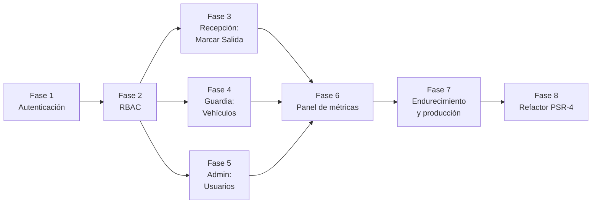

# Hoja de Ruta del Backend Pendiente

**Sistema de Registro y Control de Accesos** · Auditoría técnica y plan de implementación para los 3 roles

| Campo | Valor |
|---|---|
| Fecha de auditoría | 22 de octubre de 2026 |
| Rama auditada | `main` |
| Estado de pruebas al auditar | 29 pruebas, 164 aserciones, 0 fallos |
| Alcance | `app/`, `database/`, `routes/`, `bootstrap/app.php`, `config/`, `tests/` |

> Este documento indica **qué falta programar y en qué orden**. Los fragmentos de código son una guía de referencia; ajústalos a tu estilo antes de pegarlos. El frontend (páginas React) de cada funcionalidad nueva se construye **después** de que existan sus rutas y props.

---

## 1. Diagnóstico del backend actual

### 1.1 Lo que ya está bien resuelto

| Aspecto | Evidencia |
|---|---|
| Separación en capas Controlador → Servicio → Modelo | `app/service/*` inyectados por constructor |
| Validación desacoplada | 6 FormRequests con mensajes en español |
| Integridad referencial | FKs `visitor_id`, `department_id`, `user_id` en `visits` |
| Columna de rol ya creada | `users.role` enum `admin | guardia | recepcion` |
| Pruebas de integración de los 3 CRUD | 27 Feature Tests con `RefreshDatabase` |
| Contenedor y despliegue | `Dockerfile` multi-etapa + `render.yaml` |

### 1.2 Brechas frente al diseño de 3 roles

| # | Brecha | Impacto | Prioridad |
|---|---|---|---|
| B1 | No hay inicio de sesión ni middleware `auth`: **todas las rutas son públicas**. | Cualquier persona con la URL puede crear, editar o borrar registros. | 🔴 Crítica |
| B2 | La columna `role` no se evalúa en ningún lugar; todas las FormRequests devuelven `authorize(): true`. | No existe RBAC real. | 🔴 Crítica |
| B3 | `--seed` en el `CMD` del `Dockerfile` crea `guardia@registro.test` / `password` **en producción**. | En cuanto exista login será una credencial pública. | 🔴 Crítica (al activar B1) |
| B4 | No existe "Marcar Salida" (`exit_time = now()`); la salida se escribe a mano. | Operación lenta y propensa a errores. | 🟠 Alta |
| B5 | `user_id` y `entry_time` de la visita los elige el operador en el formulario. | Se puede registrar una visita a nombre de otro usuario o con hora falsa. | 🟠 Alta |
| B6 | No existe el módulo de vehículos (migración, modelo, servicio, controlador, rutas). | El rol Guardia no tiene funcionalidad. | 🟠 Alta |
| B7 | `UserController` es una plantilla vacía sin rutas. | El administrador no puede gestionar usuarios ni roles. | 🟠 Alta |
| B8 | `visits.user_id` tiene `ON DELETE CASCADE`. | **Borrar un usuario borra todas las visitas que registró** (pérdida de auditoría). | 🟠 Alta |
| B9 | `timezone => 'UTC'` en `config/app.php`. | El listado muestra hora local (el navegador convierte), pero el formulario de edición muestra la hora UTC: en México hay 6 h de diferencia. | 🟡 Media |
| B10 | Unicidad de `departments.name` y `visitors.identification_number` solo en FormRequests, sin índice `unique` en BD. | Dos peticiones simultáneas pueden crear duplicados. | 🟡 Media |
| B11 | La tabla `users` no tiene `remember_token`, aunque el modelo hereda de `Authenticatable`. | "Recordarme" en el login fallará. | 🟡 Media |
| B12 | `Departmentscontroller::index()` no usa el servicio y `show()` está vacío con ruta registrada. | Inconsistencia de arquitectura; `GET /departamentos/{id}` responde vacío. | 🟢 Baja |
| B13 | Sin HTTPS forzado ni `trustProxies` para Render. | Riesgo de contenido mixto (assets por `http://`). | 🟡 Media |
| B14 | `visitSeeder` usa `visitor_id = 1` fijo. | Falla si el primer visitante no tiene id 1 (p. ej. en PostgreSQL tras borrados). | 🟢 Baja |
| B15 | Nombres fuera de PSR-4/convención Laravel (`departments`, `homecontroller`, `App\service`). | Dificulta el mantenimiento y confunde a nuevos desarrolladores. | 🟢 Baja (refactor final) |
| B16 | `APP_LOCALE=en`: los mensajes de validación por defecto salen en inglés (*"The reason field is required."*). | Mezcla de idiomas para el usuario final. | 🟢 Baja |

---

## 2. Orden de implementación recomendado



**Regla de trabajo:** una fase = una rama = un *pull request*, con `php artisan test` en verde antes de fusionar.

---

## 3. Fase 1 · Autenticación

Laravel 13 ya no ofrece Breeze para proyectos existentes, por lo que se recomienda una autenticación **manual y mínima** basada en sesión. Es suficiente para un sistema interno.

### 3.1 Migración: `remember_token` y usuarios activos

```bash
php artisan make:migration add_remember_token_and_is_active_to_users_table --table=users
```

```php
public function up(): void
{
    Schema::table('users', function (Blueprint $table) {
        $table->rememberToken();
        $table->boolean('is_active')->default(true)->after('role');
    });
}

public function down(): void
{
    Schema::table('users', function (Blueprint $table) {
        $table->dropColumn(['remember_token', 'is_active']);
    });
}
```

> `is_active` permite **desactivar** a un operador en lugar de borrarlo, preservando la auditoría (ver B8).

### 3.2 Controlador y FormRequest de login

```bash
php artisan make:controller Auth/AuthenticatedSessionController
php artisan make:request Auth/LoginRequest
```

```php
// app/Http/Requests/Auth/LoginRequest.php
public function rules(): array
{
    return [
        'email' => ['required', 'string', 'email'],
        'password' => ['required', 'string'],
    ];
}
```

```php
// app/Http/Controllers/Auth/AuthenticatedSessionController.php
public function create()
{
    return Inertia::render('Auth/Login');
}

public function store(LoginRequest $request)
{
    $credentials = [...$request->validated(), 'is_active' => true];

    if (! Auth::attempt($credentials, $request->boolean('remember'))) {
        throw ValidationException::withMessages([
            'email' => 'Las credenciales no son válidas.',
        ]);
    }

    $request->session()->regenerate();

    return redirect()->intended('/');
}

public function destroy(Request $request)
{
    Auth::logout();
    $request->session()->invalidate();
    $request->session()->regenerateToken();

    return redirect()->route('login');
}
```

> Agrega *rate limiting* al login (`->middleware('throttle:5,1')` en la ruta) para mitigar ataques de fuerza bruta.

### 3.3 Compartir el usuario autenticado con React

En `app/Http/Middleware/HandleInertiaRequests.php`, dentro de `share()`:

```php
'auth' => [
    'user' => fn () => $request->user()?->only('id', 'name', 'email', 'role'),
],
```

Con esto el frontend podrá mostrar el nombre del usuario en la barra lateral y ocultar los módulos que su rol no puede usar.

---

## 4. Fase 2 · Control de Acceso Basado en Roles (RBAC)

### 4.1 Enum de roles

```bash
php artisan make:enum Enums/UserRole
```

```php
// app/Enums/UserRole.php
enum UserRole: string
{
    case Admin = 'admin';
    case Recepcion = 'recepcion';
    case Guardia = 'guardia';
}
```

En `app/Models/User.php`:

```php
#[Fillable(['name', 'email', 'password', 'role', 'is_active'])]

protected function casts(): array
{
    return [
        'password' => 'hashed',
        'role' => UserRole::class,
        'is_active' => 'boolean',
    ];
}

public function hasRole(UserRole ...$roles): bool
{
    return in_array($this->role, $roles, true);
}
```

> Al castear `role` a enum, `$user->role` deja de ser `string`. Revisa cualquier comparación existente (`=== 'admin'`) y cámbiala a `UserRole::Admin`.

### 4.2 Middleware de rol

```bash
php artisan make:middleware EnsureUserHasRole
```

```php
// app/Http/Middleware/EnsureUserHasRole.php
public function handle(Request $request, Closure $next, string ...$roles): Response
{
    $user = $request->user();

    if (! $user || ! in_array($user->role->value, $roles, true)) {
        abort(403, 'No tienes permiso para acceder a este módulo.');
    }

    return $next($request);
}
```

### 4.3 Registro en `bootstrap/app.php`

```php
->withMiddleware(function (Middleware $middleware) {
    $middleware->web(append: [
        \App\Http\Middleware\HandleInertiaRequests::class,
    ]);

    $middleware->alias([
        'role' => \App\Http\Middleware\EnsureUserHasRole::class,
    ]);

    // A dónde enviar a quien no ha iniciado sesión
    $middleware->redirectGuestsTo('/login');

    // Render termina TLS en su proxy (ver Fase 7)
    $middleware->trustProxies(at: '*');
})
```

### 4.4 Estructura final de `routes/web.php`

```php
// Invitados
Route::middleware('guest')->group(function () {
    Route::get('/login', [AuthenticatedSessionController::class, 'create'])->name('login');
    Route::post('/login', [AuthenticatedSessionController::class, 'store'])->middleware('throttle:5,1');
});

Route::middleware('auth')->group(function () {
    Route::post('/logout', [AuthenticatedSessionController::class, 'destroy'])->name('logout');
    Route::get('/', homecontroller::class)->name('home');

    // Consulta del directorio: todos los roles
    Route::get('/departamentos', [Departmentscontroller::class, 'index'])->name('departments.index');

    // ADMINISTRADOR: usuarios y alta/edición/baja de departamentos
    Route::middleware('role:admin')->group(function () {
        Route::resource('usuarios', UserController::class)
            ->parameters(['usuarios' => 'id'])
            ->names('users');
        Route::get('/departamentos/crear', [Departmentscontroller::class, 'create'])->name('departments.create');
        Route::post('/departamentos', [Departmentscontroller::class, 'store'])->name('departments.store');
        Route::get('/departamentos/{id}/editar', [Departmentscontroller::class, 'edit'])->name('departments.edit');
        Route::put('/departamentos/{id}', [Departmentscontroller::class, 'update'])->name('departments.update');
        Route::delete('/departamentos/{id}', [Departmentscontroller::class, 'destroy'])->name('departments.destroy');
        Route::delete('/visitantes/{id}', [VisitorController::class, 'destroy'])->name('visitors.destroy');
        Route::delete('/visitas/{id}', [VisitController::class, 'destroy'])->name('visits.destroy');
    });

    // RECEPCIÓN (+ admin): visitantes y visitas
    Route::middleware('role:admin,recepcion')->group(function () {
        Route::get('/visitantes', [VisitorController::class, 'index'])->name('visitors.index');
        Route::get('/visitantes/crear', [VisitorController::class, 'create'])->name('visitors.create');
        Route::post('/visitantes', [VisitorController::class, 'store'])->name('visitors.store');
        Route::get('/visitantes/{id}', [VisitorController::class, 'show'])->name('visitors.show');
        Route::get('/visitantes/{id}/editar', [VisitorController::class, 'edit'])->name('visitors.edit');
        Route::put('/visitantes/{id}', [VisitorController::class, 'update'])->name('visitors.update');

        Route::get('/visitas/crear', [VisitController::class, 'create'])->name('visits.create');
        Route::post('/visitas', [VisitController::class, 'store'])->name('visits.store');
        Route::get('/visitas/{id}/editar', [VisitController::class, 'edit'])->name('visits.edit');
        Route::put('/visitas/{id}', [VisitController::class, 'update'])->name('visits.update');
        Route::patch('/visitas/{id}/salida', [VisitController::class, 'markExit'])->name('visits.exit');
    });

    // Consulta de visitas: admin, recepción y guardia (verificar quién está dentro)
    Route::middleware('role:admin,recepcion,guardia')->group(function () {
        Route::get('/visitas', [VisitController::class, 'index'])->name('visits.index');
        Route::get('/visitas/{id}', [VisitController::class, 'show'])->name('visits.show');
    });

    // GUARDIA (+ admin): bitácora vehicular
    Route::middleware('role:admin,guardia')->group(function () {
        Route::get('/vehiculos', [VehicleController::class, 'index'])->name('vehicles.index');
        Route::get('/vehiculos/crear', [VehicleController::class, 'create'])->name('vehicles.create');
        Route::post('/vehiculos', [VehicleController::class, 'store'])->name('vehicles.store');
        Route::get('/vehiculos/{id}/editar', [VehicleController::class, 'edit'])->name('vehicles.edit');
        Route::put('/vehiculos/{id}', [VehicleController::class, 'update'])->name('vehicles.update');
        Route::patch('/vehiculos/{id}/salida', [VehicleController::class, 'markExit'])->name('vehicles.exit');
    });

    Route::delete('/vehiculos/{id}', [VehicleController::class, 'destroy'])
        ->middleware('role:admin')
        ->name('vehicles.destroy');
});
```

> **Orden importante:** `/visitas/crear` debe declararse **antes** que `/visitas/{id}`; de lo contrario, Laravel interpretará "crear" como un `{id}`. En el bloque anterior, el grupo de recepción se declara primero por esa razón. Si prefieres evitar el problema, agrega `->whereNumber('id')` a las rutas con `{id}`.

### 4.5 Autorización fina en FormRequests

```php
// StoreVisitRequest / UpdateVisitRequest
public function authorize(): bool
{
    return $this->user()?->hasRole(UserRole::Admin, UserRole::Recepcion) ?? false;
}
```

El middleware de ruta es la primera barrera; `authorize()` es la segunda (defensa en profundidad).

### 4.6 Impacto en las pruebas existentes

Al proteger las rutas con `auth`, **las 27 pruebas CRUD actuales recibirán `302 → /login`**. Agrega al inicio de cada prueba (o en `setUp()`):

```php
protected function setUp(): void
{
    parent::setUp();
    $this->actingAs(User::factory()->create(['role' => 'admin']));
}
```

Y agrega estados a `UserFactory` para probar cada rol:

```php
public function admin(): static     { return $this->state(['role' => 'admin']); }
public function recepcion(): static { return $this->state(['role' => 'recepcion']); }
public function guardia(): static   { return $this->state(['role' => 'guardia']); }
```

---

## 5. Fase 3 · Recepción: asignación automática y "Marcar Salida"

### 5.1 Usuario y hora de entrada automáticos (B5)

Quita `user_id` y `entry_time` de las reglas de `StoreVisitRequest` y asígnalos en el controlador:

```php
// VisitController::store()
$this->visitService->create([
    ...$request->validated(),
    'user_id' => $request->user()->id,
    'entry_time' => now(),
    'status' => 'dentro',
]);
```

Después, el selector "Usuario responsable" y los campos de entrada/estado del alta se retiran del formulario React (yo puedo hacer ese ajuste visual cuando el backend esté listo).

### 5.2 Método `markExit` (B4)

```php
// app/service/visits/VisitService.php
public function markExit(int $id): bool
{
    return visits::where('id', $id)
        ->whereNull('exit_time')
        ->update(['exit_time' => now(), 'status' => 'completado']) > 0;
}
```

```php
// app/Http/Controllers/VisitController.php
public function markExit(int $id)
{
    $updated = $this->visitService->markExit($id);

    return back()->with('message', $updated
        ? 'Salida registrada correctamente.'
        : 'La visita ya tenía una salida registrada.');
}
```

La condición `whereNull('exit_time')` hace la operación **idempotente**: un doble clic no sobrescribe la hora original.

### 5.3 Métodos de consulta útiles para Recepción

```php
// VisitService
public function getInside(): Collection
{
    return visits::with(['visitor', 'department'])
        ->where('status', 'dentro')
        ->whereNull('exit_time')
        ->latest('entry_time')
        ->get();
}
```

### 5.4 Opcional: quién registró la salida

```bash
php artisan make:migration add_exited_by_to_visits_table --table=visits
```

```php
$table->foreignId('exited_by')->nullable()->after('exit_time')->constrained('users')->nullOnDelete();
```

---

## 6. Fase 4 · Guardia: bitácora vehicular (B6)

### 6.1 Generar los archivos

Para código **nuevo** se recomienda seguir desde ya la convención de Laravel (modelo en singular y PascalCase):

```bash
php artisan make:model Vehicle -mfs          # modelo + migración + factory + seeder
php artisan make:controller VehicleController
php artisan make:request Vehicles/StoreVehicleRequest
php artisan make:request Vehicles/UpdateVehicleRequest
php artisan make:class service/vehicles/VehicleService
php artisan make:test VehiclesCrudTest
```

### 6.2 Migración `create_vehicles_table`

```php
public function up(): void
{
    Schema::create('vehicles', function (Blueprint $table) {
        $table->id();
        $table->foreignId('user_id')->constrained('users')->restrictOnDelete();       // guardia que registró
        $table->foreignId('visitor_id')->nullable()->constrained('visitors')->nullOnDelete(); // visitante asociado (opcional)
        $table->string('plate_number', 15);
        $table->string('brand', 100);
        $table->string('color', 50);
        $table->enum('vehicle_type', ['sedan', 'camioneta', 'motocicleta', 'pickup', 'otro']);
        $table->string('driver_name')->nullable();
        $table->timestamp('entry_time')->useCurrent();
        $table->timestamp('exit_time')->nullable();
        $table->timestamps();

        $table->index(['plate_number', 'exit_time']); // búsqueda rápida de ingresos abiertos por placa
    });
}
```

| Columna | Tipo | Restricción | Motivo |
|---|---|---|---|
| `user_id` | FK `users` | `RESTRICT` | No se puede borrar a un guardia con registros (auditoría) |
| `visitor_id` | FK `visitors` | Nullable, `SET NULL` | Proveedores o visitantes no registrados |
| `plate_number` | `VARCHAR(15)` | Índice compuesto | Se normaliza a mayúsculas sin espacios |
| `vehicle_type` | `ENUM` | 5 valores | Catálogo cerrado y filtrable |
| `entry_time` | `TIMESTAMP` | `DEFAULT CURRENT_TIMESTAMP` | Hora automática |
| `exit_time` | `TIMESTAMP` | Nullable | `NULL` = vehículo dentro |

### 6.3 Modelo

```php
class Vehicle extends Model
{
    use HasFactory;

    protected $fillable = [
        'user_id', 'visitor_id', 'plate_number', 'brand', 'color',
        'vehicle_type', 'driver_name', 'entry_time', 'exit_time',
    ];

    protected function casts(): array
    {
        return ['entry_time' => 'datetime', 'exit_time' => 'datetime'];
    }

    protected function plateNumber(): Attribute
    {
        return Attribute::make(set: fn (string $value) => strtoupper(str_replace([' ', '-'], '', $value)));
    }

    public function user(): BelongsTo    { return $this->belongsTo(User::class); }
    public function visitor(): BelongsTo { return $this->belongsTo(visitors::class); }
}
```

### 6.4 FormRequest con la regla "no dos ingresos abiertos por placa"

```php
// StoreVehicleRequest
protected function prepareForValidation(): void
{
    $this->merge([
        'plate_number' => strtoupper(str_replace([' ', '-'], '', (string) $this->plate_number)),
    ]);
}

public function rules(): array
{
    return [
        'plate_number' => [
            'required', 'string', 'max:15', 'regex:/^[A-Z0-9]+$/',
            Rule::unique('vehicles', 'plate_number')->whereNull('exit_time'),
        ],
        'brand' => ['required', 'string', 'max:100'],
        'color' => ['required', 'string', 'max:50'],
        'vehicle_type' => ['required', Rule::in(['sedan', 'camioneta', 'motocicleta', 'pickup', 'otro'])],
        'driver_name' => ['nullable', 'string', 'max:255'],
        'visitor_id' => ['nullable', 'integer', 'exists:visitors,id'],
    ];
}

public function messages(): array
{
    return ['plate_number.unique' => 'Este vehículo ya tiene un ingreso abierto.'];
}
```

### 6.5 Servicio

| Método | Responsabilidad |
|---|---|
| `getAll(): LengthAwarePaginator` | Lista con `with(['user', 'visitor'])`, `latest('entry_time')`, 10 por página |
| `getInside(): Collection` | Vehículos con `exit_time IS NULL` |
| `create(array $data): Vehicle` | Alta (el controlador agrega `user_id` y `entry_time`) |
| `find(int $id): Vehicle` | `findOrFail` |
| `update(int $id, array $data): bool` | Edición |
| `markExit(int $id): bool` | `whereNull('exit_time')->update(['exit_time' => now()])` |
| `delete(int $id): bool` | Solo admin |

### 6.6 Contrato de props para el frontend

Para que yo pueda construir las páginas React del módulo, el controlador debería enviar:

| Página | Props |
|---|---|
| `Vehicles/Index` | `vehicles` (paginador con `user` y `visitor`) |
| `Vehicles/Form` | `vehicle?`, `visitors` (para el selector opcional), `vehicleTypes` (arreglo de valores del enum) |

---

## 7. Fase 5 · Administrador: usuarios y roles (B7)

```bash
php artisan make:request Users/StoreUserRequest
php artisan make:request Users/UpdateUserRequest
php artisan make:class service/users/UserService
php artisan make:test UsersCrudTest
```

```php
// StoreUserRequest
public function rules(): array
{
    return [
        'name' => ['required', 'string', 'max:255'],
        'email' => ['required', 'email', 'max:255', 'unique:users,email'],
        'password' => ['required', 'confirmed', Password::defaults()],
        'role' => ['required', Rule::enum(UserRole::class)],
    ];
}
```

En `UpdateUserRequest`: `Rule::unique('users', 'email')->ignore($this->route('id'))` y `password` como `nullable`.

**Reglas de negocio recomendadas en `UserService`:**

1. Un administrador **no puede desactivarse ni eliminarse a sí mismo**.
2. Debe existir siempre **al menos un administrador activo**.
3. En lugar de `delete()`, usar `is_active = false` (B8).

---

## 8. Fase 6 · Panel de métricas para el Administrador

Convertir `homecontroller` para que envíe indicadores reales:

```php
public function __invoke()
{
    return Inertia::render('Home/Index', [
        'stats' => [
            'visitsToday' => visits::whereDate('entry_time', today())->count(),
            'peopleInside' => visits::where('status', 'dentro')->whereNull('exit_time')->count(),
            'vehiclesInside' => Vehicle::whereNull('exit_time')->count(),
            'withoutBadge' => visits::where('status', 'dentro')->whereNull('badge_number')->count(),
        ],
    ]);
}
```

> Hoy los KPIs de `Visits/Index` se calculan con los registros **de la página actual**; con este endpoint se mostrarán totales reales.

---

## 9. Fase 7 · Endurecimiento y producción

### 9.1 Índices únicos (B10)

```bash
php artisan make:migration add_unique_indexes_to_departments_and_visitors
```

```php
Schema::table('departments', fn (Blueprint $t) => $t->unique('name'));
Schema::table('visitors', fn (Blueprint $t) => $t->unique('identification_number'));
```

### 9.2 Proteger la auditoría (B8)

- Preferir `is_active` en usuarios en lugar de borrarlos.
- Opcional: `SoftDeletes` en `visitors` y `departments` (`$table->softDeletes();` + trait `SoftDeletes` en el modelo).
- Opcional: cambiar `visits.user_id` a `restrictOnDelete()`. Requiere eliminar y volver a crear la FK. Pruébalo primero en SQLite local y en una copia de PostgreSQL.

### 9.3 Zona horaria (B9)

En `config/app.php`:

```php
'timezone' => env('APP_TIMEZONE', 'America/Mexico_City'),
```

Y agrega `APP_TIMEZONE=America/Mexico_City` en Render. Verifica después que `Visits/Form` muestre la misma hora que el listado.

### 9.4 HTTPS detrás del proxy de Render (B13)

```php
// app/Providers/AppServiceProvider.php
public function boot(): void
{
    if ($this->app->environment('production')) {
        URL::forceScheme('https');
    }
}
```

Además de `trustProxies(at: '*')` en `bootstrap/app.php` (sección 4.3).

### 9.5 Seeders seguros (B3, B14)

1. Quita `--seed` del `CMD` del `Dockerfile`: `CMD php artisan migrate --force && apache2-foreground`.
2. Crea `AdminUserSeeder` que lea el correo y la contraseña de variables de entorno (`ADMIN_EMAIL`, `ADMIN_PASSWORD`). Ejecútalo **una sola vez** desde la consola de Render.
3. En `visitSeeder`, reemplaza `visitor_id = 1` por `visitors::firstOrFail()->id`.

### 9.6 Mensajes en español (B16)

```bash
php artisan lang:publish
```

Después, en `.env` y en Render, define `APP_LOCALE=es` y traduce `lang/es/validation.php`, o instala un paquete comunitario de traducciones al español.

### 9.7 Consistencia (B12)

- Agregar `getAll()` a `DepartmentService` y usarlo en `Departmentscontroller::index()`.
- Implementar `Departmentscontroller::show()` o eliminar la ruta `departments.show`.

---

## 10. Fase 8 · Estandarización de nombres (PSR-4 y convenciones de Laravel)

Hazlo **al final**, en una rama propia y **un cambio a la vez**, ejecutando `php artisan test` después de cada paso.

| Actual | Recomendado | Archivos afectados |
|---|---|---|
| `App\Models\departments` | `App\Models\Department` | Modelo, factory (`DepartmentFactory`), seeders, servicio, controlador, tests |
| `App\Models\visitors` | `App\Models\Visitor` | Ídem |
| `App\Models\visits` | `App\Models\Visit` | Ídem + relaciones `hasMany(Visit::class)` |
| `App\service\*` (carpeta `app/service`) | `App\Services\*` (carpeta `app/Services`) | Los 3 servicios y sus `use` |
| `homecontroller` | `HomeController` | Controlador + `routes/web.php` |
| `Departmentscontroller` | `DepartmentController` | Controlador + `routes/web.php` |
| `departmentseeder`, `visitSeeder`, `visitorSeeder` | `DepartmentSeeder`, `VisitSeeder`, `VisitorSeeder` | Seeders + `DatabaseSeeder` |

**Notas:**

- Con el nombre en singular ya no necesitarás `protected $table`: Eloquent infiere `departments` a partir de `Department`.
- Las factories se resuelven por nombre: `Department` busca `Database\Factories\DepartmentFactory`.
- En sistemas sensibles a mayúsculas (Linux, Docker, Render), un cambio solo de mayúsculas requiere dos pasos en Git: `git mv app/service app/Services_tmp && git mv app/Services_tmp app/Services`.
- Tras renombrar, ejecuta `composer dump-autoload`.

---

## 11. Lista ordenada de comandos

```bash
# ── Preparación ────────────────────────────────────────────────
git checkout -b feature/auth-rbac
php artisan test                                   # línea base en verde

# ── Fase 1: Autenticación ──────────────────────────────────────
php artisan make:migration add_remember_token_and_is_active_to_users_table --table=users
php artisan make:controller Auth/AuthenticatedSessionController
php artisan make:request Auth/LoginRequest
php artisan migrate

# ── Fase 2: RBAC ───────────────────────────────────────────────
php artisan make:enum Enums/UserRole
php artisan make:middleware EnsureUserHasRole
php artisan make:test RoleAccessTest
#   → editar bootstrap/app.php, routes/web.php, User.php, FormRequests
#   → agregar actingAs() a las pruebas existentes
php artisan route:list                              # verificar middleware por ruta
php artisan test

# ── Fase 3: Recepción ──────────────────────────────────────────
php artisan make:migration add_exited_by_to_visits_table --table=visits   # opcional
php artisan make:test MarkExitTest
php artisan migrate
php artisan test

# ── Fase 4: Guardia / Vehículos ────────────────────────────────
php artisan make:model Vehicle -mfs
php artisan make:controller VehicleController
php artisan make:request Vehicles/StoreVehicleRequest
php artisan make:request Vehicles/UpdateVehicleRequest
php artisan make:class service/vehicles/VehicleService
php artisan make:test VehiclesCrudTest
php artisan migrate
php artisan test

# ── Fase 5: Usuarios ───────────────────────────────────────────
php artisan make:request Users/StoreUserRequest
php artisan make:request Users/UpdateUserRequest
php artisan make:class service/users/UserService
php artisan make:test UsersCrudTest
php artisan test

# ── Fase 7: Endurecimiento ─────────────────────────────────────
php artisan make:migration add_unique_indexes_to_departments_and_visitors
php artisan make:seeder AdminUserSeeder
php artisan migrate
php artisan test

# ── Verificación final ────────────────────────────────────────
php artisan migrate:fresh --seed                   # solo en local: reconstruye la BD
php artisan route:list --except-vendor
php artisan test
npm run build
```

---

## 12. Plan de pruebas para las nuevas funcionalidades

| Prueba | Casos mínimos |
|---|---|
| `AuthenticationTest` | Login válido redirige a `/`; credenciales inválidas muestran error; usuario inactivo no entra; invitado en `/visitas` → `/login`; logout invalida la sesión |
| `RoleAccessTest` | `guardia` → `POST /visitas` = 403; `recepcion` → `GET /vehiculos` = 403; `recepcion` → `GET /usuarios` = 403; `admin` accede a todo |
| `MarkExitTest` | Asigna `exit_time` y `status = completado`; no sobrescribe una salida existente; `guardia` recibe 403 |
| `VehiclesCrudTest` | CRUD completo; placa normalizada a mayúsculas; rechaza segundo ingreso abierto con la misma placa; acepta la misma placa después de su salida |
| `UsersCrudTest` | Alta con rol; correo único; contraseña confirmada; el admin no puede desactivarse a sí mismo |

---

## 13. Lista de verificación

- [ ] Fase 1 · Login y logout funcionando; rutas protegidas con `auth`
- [ ] Fase 2 · Middleware `role` aplicado según la matriz de permisos; pruebas con `actingAs`
- [ ] Fase 3 · Botón "Marcar Salida"; `user_id` y `entry_time` automáticos
- [ ] Fase 4 · Módulo de vehículos con regla de placa abierta
- [ ] Fase 5 · CRUD de usuarios con roles y desactivación
- [ ] Fase 6 · Métricas reales en el panel principal
- [ ] Fase 7 · Índices únicos, zona horaria, HTTPS, seeders seguros, idioma español
- [ ] Fase 8 · Nombres estandarizados PSR-4
